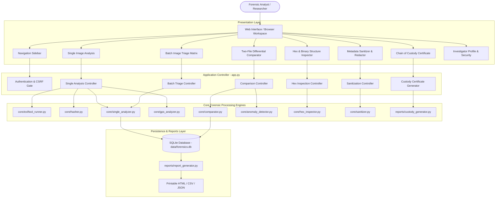

# Comprehensive Technical Documentation: TRACE Digital Forensics Workbench
**Metadata Tampering Detection in Media Files Using ExifTool**

---

## 1. Executive Summary & Project Identification

* **Project Title**: Metadata Tampering Detection in Media Files Using ExifTool
* **System Brand**: TRACE — Digital Forensics Workbench
* **Lead Researcher & Developer**: Kappala Bhuvana Kruthi
* **Academic Institution**: Centurion University of Technology and Management (CUTM)
* **Domain**: Applied Digital Forensics, Media Integrity Verification, Steganography Detection
* **Primary Objective**: Design, engineer, and deploy an academic and courtroom-grade digital forensics workbench capable of extracting internal media metadata, identifying timestamp manipulations and editing signatures, executing differential comparisons, detecting hidden payloads past file EOF, mapping GPS spatial telemetry, and generating cryptographically signed chain-of-custody documentation.

---

## 2. Technology Stack & Environment

| Layer | Technologies & Libraries | Function |
| :--- | :--- | :--- |
| **Backend Runtime** | Python 3.13.12 | Core execution environment |
| **Web Framework** | Flask 3.1.x, Werkzeug | HTTP routing, session state, CSRF security |
| **Forensic Extraction Engine** | Phil Harvey's ExifTool (via subprocess JSON pipe) | Deep extraction of EXIF, IPTC, XMP, MakerNotes |
| **Cryptographic Hashing** | Python `hashlib` (SHA-256, SHA-1, MD5) | Bit-level evidentiary hashing and tamper verification |
| **Pixel & Image Processing** | Pillow (PIL) | JPEG quantization analysis, Error Level Analysis (ELA) |
| **Database & Persistence** | SQLite3 Relational Database | Relational storage for cases, users, audit logs, preferences |
| **Frontend Architecture** | Semantic HTML5, Vanilla CSS Design System | Responsive, accessible interface with zero bulky dependencies |
| **Styling & Aesthetics** | Curated Navy/Blue Palette (`#14243A`, `#2563EB`, `#F5F7FA`) | Professional digital forensics lab aesthetic (Dark/Light mode) |
| **Testing Framework** | Pytest 9.2.0 | Automated unit, regression, and integration testing (55 tests) |

---

## 3. High-Level System Architecture



---

## 4. End-to-End Forensic Engine Modules

### 4.1. Single Image Authenticity Analysis Engine (`core/single_analyzer.py`)
Designed to evaluate standalone media files where an original reference copy is unavailable.
* **Image Source Context Ingestion**:
  * Evaluates evidence based on investigator-declared provenance:
    1. *Captured using a camera or phone* (expects rich EXIF, camera make/model, shutter, aperture).
    2. *Downloaded from a website or social media platform* (Pinterest, Instagram, Facebook, Twitter).
    3. *Received through a messaging application* (WhatsApp, Telegram, Signal).
    4. *Source unknown*.
  * **Social Media Transparency**: Correctly identifies stripped metadata in social media uploads as standard platform privacy scrubbing (`INFORMATIONAL`/`EXPECTED`), preventing false-positive tampering declarations.
* **Chronological Inconsistency Rules**:
  * Detects when `ModifyDate` chronologically precedes `DateTimeOriginal`.
  * Detects when `CreateDate` precedes `DateTimeOriginal` by more than 24 hours.
* **Editing Software Signature Detection**:
  * Evaluates tags: `Software`, `CreatorTool`, `HistorySoftwareAgent`, `ProcessingSoftware`.
  * Matches against a dictionary of editors (Photoshop, GIMP, Canva, Lightroom, Snapseed, ExifTool, Pixlr, ImageMagick).
* **Format & Extension Mismatch**:
  * Cross-references file extension against internal EXIF `FileType` and MIME type.
* **Advanced Pixel & Compression Diagnostics**:
  * Extracts JPEG quantization tables (DQT) and computes variance.
  * Conducts non-destructive Error Level Analysis (ELA) measuring mean error levels and standard deviations across 8x8 DCT compression blocks.
* **Defensible Forensic Classification**:
  * `SUSPICIOUS_INDICATORS_FOUND`: Documented contradictions or editing tool traces identified.
  * `INCONCLUSIVE`: Sparse or stripped metadata (insufficient data to corroborate authenticity).
  * `NO_SIGNIFICANT_INDICATORS`: Checks completed without contradictions (includes explicit disclaimer that absence of indicators does not prove absence of tampering).

---

### 4.2. GPS Forensics & Spatial Geolocation (`core/gps_analyzer.py`)
* **DMS Coordinate Decoding**: Parses degrees, minutes, and seconds from strings (e.g., `18 deg 48' 19.80" N`) into signed decimal degrees (`18.805500, 84.143500`).
* **Terrestrial Bounding Checks**: Validates latitude within `[-90, 90]` and longitude within `[-180, 180]`. Detects synthetic `(0.0, 0.0)` "Null Island" coordinates.
* **Satellite vs. Camera Clock Sync**: Compares atomic GPS satellite timestamps (`GPSTimeStamp` + `GPSDateStamp` UTC) against camera local timestamps (`DateTimeOriginal`), surfacing temporal discrepancies.
* **Mapping Integration**: Constructs embeddable OpenStreetMap iframes and direct links to OpenStreetMap and Google Maps.

---

### 4.3. Hex & Low-Level Binary Structure Inspector (`core/hex_inspector.py`)
* **Magic Byte Verification**: Verifies first byte signatures against specifications (JPEG `FF D8 FF`, PNG `89 50 4E 47`, GIF `47 49 46 38`, TIFF `49 49 2A 00` / `4D 4D 00 2A`, WebP `52 49 46 46`).
* **Segment Marker Mapping**: Scans JPEG binary streams to catalogue offsets, markers, and segment lengths:
  * `SOI` (`FF D8`), `APP0 JFIF` (`FF E0`), `APP1 EXIF` (`FF E1`), `APP2 ICC` (`FF E2`), `APP13 Photoshop IRB` (`FF ED`), `DQT` (`FF DB`), `SOF0` (`FF C0`), `DHT` (`FF C4`), `SOS` (`FF DA`), `EOI` (`FF D9`).
* **Steganography & Post-EOF Payload Scan**: Detects data appended past the official End-of-Image marker (`FF D9` for JPEG, `IEND` for PNG), surfacing hidden RAR/ZIP archives, malicious scripts, or injected polyglots.
* **Hex Preview Generator**: Renders standard 16-byte offset rows with hexadecimal byte representations and printable ASCII columns for the file header and trailer.

---

### 4.4. Metadata Sanitizer & Privacy Redactor (`core/sanitizer.py`)
* **Redaction Modes**:
  1. *Complete Privacy Scrub*: Safely purges all EXIF, GPS, IPTC, XMP, device serials, and thumbnail data while maintaining essential color space tags.
  2. *Selective GPS Stripping*: Purges only GNSS coordinates and location tags, preserving camera settings and lens profiles.
* **Cryptographic Differential**: Computes before-and-after SHA-256 digests, exact byte reduction, and generates an itemized table of all stripped tags and their prior values.
* **Download Delivery**: Serves sanitized media files via a secure download endpoint.

---

### 4.5. Multi-Image Batch Triage Matrix (`app.py` & `templates/batch_analysis.html`)
* **Batch Ingestion**: Accepts up to 15 media files simultaneously.
* **Rapid Evidentiary Triage**: Processes each image through ExifTool and rule-based anomaly detection.
* **Batch KPI Dashboard**: Summary metrics for Total Files, Flagged/Suspicious, Consistent, and Stripped/Inconclusive.
* **Triage Table**: Lists filename, byte size, SHA-256 digest, hardware model, capture date, status badge, and findings count.
* **Batch Export**: Instant client-side CSV export of the complete triage matrix.

---

### 4.6. Two-File Differential Comparator (`core/comparator.py`)
* **Differential Classification**:
  * Added Tags: Metadata present in File B but absent in File A.
  * Removed Tags: Metadata present in File A but purged in File B.
  * Modified Tags: Tags with identical names but differing values.
  * Identical Tags: Unaltered baseline tags.
* **Categorized Inspection**: Groups tags by namespace (EXIF, IPTC, XMP, File, Composite).
* **Summary Metrics**: Calculates overall match percentage and highlights timestamp or hardware discrepancies.

---

### 4.7. Cryptographic Hashing Engine (`core/hasher.py`)
* **Multi-Digest Hashing**: Computes block-streamed SHA-256 (primary standard), SHA-1 (secondary), and MD5 (legacy) in 64 KB chunks.
* **Objective Forensic Statement**:
  * Identical Hashes: Declares bit-for-bit duplicate files with near-absolute mathematical certainty.
  * Differing Hashes: Documents binary divergence without making false claims regarding intent or maliciousness.

---

### 4.8. Forensic Chain of Custody Certificate (`reports/custody_generator.py`)
* **Evidentiary Certificate**: Generates a standardized, printable certificate (`templates/custody_certificate.html`).
* **Cryptographic Tamper-Evident Seal**: Generates a 24-character hexadecimal seal derived from the evidence ID, SHA-256 hash, byte size, acquiring investigator ID, and UTC timestamp.
* **Environmental Fingerprint**: Inscribes ExifTool engine version, Python interpreter version, and host OS platform.
* **Transfer Ledger**: Documents multi-step custody logs (Acquisition &rarr; Sealing &rarr; Examination) with formal signature slots.

---

### 4.9. Report Generation Engine (`reports/report_generator.py`)
* **Printable Forensic Reports**: Generates formal HTML reports complete with case details, cryptographic digests, full metadata breakdowns, and legal disclaimers.
* **CSV Export**: Outputs differential comparison data in structured tabular format.
* **JSON Export**: Provides an API-compatible structured export stream for integration into law enforcement and lab LIMS pipelines.

---

## 5. Database Architecture & Schema (`core/database.py`)

The application utilizes an SQLite3 database (`data/forensics.db`) with automatic table creation and migrations:

```sql
-- Core Case Investigations
CREATE TABLE IF NOT EXISTS investigations (
    id TEXT PRIMARY KEY,
    case_title TEXT,
    analysis_type TEXT,
    created_at TEXT,
    file_a_name TEXT,
    file_a_hash TEXT,
    file_b_name TEXT,
    file_b_hash TEXT,
    notes TEXT,
    results_json TEXT,
    anomaly_count INTEGER DEFAULT 0
);

-- User Credentials & Investigator Profile
CREATE TABLE IF NOT EXISTS users (
    user_id TEXT PRIMARY KEY,
    password_hash TEXT NOT NULL,
    role TEXT DEFAULT 'lead_investigator',
    created_at TEXT,
    display_name TEXT,
    professional_title TEXT,
    bio TEXT,
    areas_of_interest TEXT,
    skills_technologies TEXT,
    avatar_initials TEXT
);

-- Workspace Appearance & Accessibility Preferences
CREATE TABLE IF NOT EXISTS user_preferences (
    user_id TEXT PRIMARY KEY,
    theme TEXT DEFAULT 'light',
    accent_color TEXT DEFAULT '#2563EB',
    density TEXT DEFAULT 'comfortable',
    sidebar_state TEXT DEFAULT 'expanded',
    reduced_motion INTEGER DEFAULT 0,
    dashboard_widgets TEXT,
    updated_at TEXT
);

-- Real-Time System Notifications
CREATE TABLE IF NOT EXISTS notifications (
    id INTEGER PRIMARY KEY AUTOINCREMENT,
    user_id TEXT NOT NULL,
    title TEXT NOT NULL,
    message TEXT NOT NULL,
    category TEXT DEFAULT 'general',
    link TEXT,
    is_read INTEGER DEFAULT 0,
    created_at TEXT
);

-- User Bookmarks & Saved Cases
CREATE TABLE IF NOT EXISTS favorites (
    id INTEGER PRIMARY KEY AUTOINCREMENT,
    user_id TEXT NOT NULL,
    item_type TEXT NOT NULL,
    item_id TEXT NOT NULL,
    item_title TEXT NOT NULL,
    item_subtitle TEXT,
    item_link TEXT,
    created_at TEXT,
    UNIQUE(user_id, item_type, item_id)
);

-- Recently Viewed Evidentiary Artifacts
CREATE TABLE IF NOT EXISTS recently_viewed (
    id INTEGER PRIMARY KEY AUTOINCREMENT,
    user_id TEXT NOT NULL,
    item_type TEXT NOT NULL,
    item_id TEXT NOT NULL,
    file_name TEXT,
    classification TEXT,
    link TEXT,
    viewed_at TEXT,
    UNIQUE(user_id, item_type, item_id)
);

-- Audit Ledger & System Custody Events
CREATE TABLE IF NOT EXISTS audit_logs (
    id INTEGER PRIMARY KEY AUTOINCREMENT,
    timestamp TEXT,
    event_type TEXT,
    details TEXT,
    investigation_id TEXT
);

-- User Feedback & Issue Reports
CREATE TABLE IF NOT EXISTS feedback (
    id INTEGER PRIMARY KEY AUTOINCREMENT,
    user_id TEXT NOT NULL,
    category TEXT,
    subject TEXT,
    description TEXT,
    steps_to_reproduce TEXT,
    error_id TEXT,
    status TEXT DEFAULT 'OPEN',
    created_at TEXT
);
```

---

## 6. Application Routing & Endpoints Map (`app.py`)

| Endpoint | HTTP Method | Access Level | Description |
| :--- | :--- | :--- | :--- |
| `/` | `GET` | Public | Brand landing page explaining architecture, methodology, and workflow |
| `/login` | `GET`, `POST` | Public | Authentication gateway with PBKDF2 verification and CSRF protection |
| `/logout` | `GET` | Authenticated | Clears session and terminates authenticated state |
| `/dashboard` | `GET` | Authenticated | Central command dashboard with KPI metrics, quick actions, and recent activity |
| `/single-analysis` | `GET`, `POST` | Authenticated | Single image analysis with source context selection and OpenStreetMap preview |
| `/batch-analysis` | `GET`, `POST` | Authenticated | Multi-image batch triage matrix and CSV export |
| `/compare` | `GET`, `POST` | Authenticated | Two-file differential comparison with side-by-side tag mapping |
| `/inspect` | `GET`, `POST` | Authenticated | Interactive raw metadata tag browser with search and namespace filtering |
| `/verify` | `GET`, `POST` | Authenticated | Standalone cryptographic hash verification and duplicate checker |
| `/hex-inspector` | `GET`, `POST` | Authenticated | Magic byte verification, segment mapping, and post-EOF payload scan |
| `/sanitizer` | `GET`, `POST` | Authenticated | Privacy redaction tool with cryptographic before/after differential |
| `/download-sanitized/<filename>` | `GET` | Authenticated | Secure file download endpoint for sanitized media outputs |
| `/history` | `GET` | Authenticated | Case history archive, audit logs, and evidentiary management |
| `/investigation/<id>/custody` | `GET` | Authenticated | Printable digital evidence Chain of Custody Certificate |
| `/report/<id>` | `GET` | Authenticated | Standalone printable comprehensive forensic examination report |
| `/export/csv/<id>` | `GET` | Authenticated | Downloadable CSV export of differential metadata comparison |
| `/export/json/<id>` | `GET` | Authenticated | Downloadable structured JSON export of case investigation record |
| `/profile` | `GET`, `POST` | Authenticated | Personal investigator profile management (credentials, bio, skills) |
| `/notifications` | `GET` | Authenticated | Notification center for analysis completions and audit events |
| `/appearance` | `GET`, `POST` | Authenticated | Customization center for Light/Dark themes, density, and accent colors |
| `/security` | `GET`, `POST` | Authenticated | Password management and security audit trail viewer |
| `/favorites` | `GET` | Authenticated | Saved cases, bookmarked reports, and quick references |
| `/activity` | `GET` | Authenticated | Historical audit ledger and factual investigation milestones |
| `/recently-viewed` | `GET` | Authenticated | History of recently opened cases and reports |
| `/help` | `GET` | Authenticated | Methodology guide, rule documentation, and FAQ center |
| `/shortcuts` | `GET` | Authenticated | Global keyboard shortcut reference (`?`, `d`, `s`, `c`, `v`, `h`, `n`) |
| `/feedback` | `GET`, `POST` | Authenticated | In-app bug report, feature suggestion, and issue logging portal |

---

## 7. User Workspace & Interface Design System

### 7.1. Aesthetics & Design Tokens
* **Color Palette**:
  * Primary Navy: `#14243A`
  * Deep Navy: `#0B1728`
  * Blue Primary: `#2563EB`
  * Light Blue Accent: `#EFF6FF`
  * Background Light: `#F5F7FA`
  * Dark Mode Surface: `#0F172A`
  * Dark Mode Card: `#1E293B`
* **Typography**: Clean, accessible Google Fonts pairing — `Inter` for interface typography and `JetBrains Mono` for hashes, hexadecimal offsets, and technical metadata.
* **Strict Aesthetic Constraints Enforced**:
  * Zero purple gradients.
  * Zero emojis in interface text (clean SVG iconography utilized).
  * Zero em/en dashes in interface copy (standard hyphens or clear punctuation).

### 7.2. Global Keyboard Shortcuts
A hotkey event listener in `static/js/app.js` enables rapid keyboard navigation (automatically suppressed while typing in input or textarea fields):
* `?`: Open Keyboard Shortcuts Help Modal
* `d`: Navigate to Dashboard
* `s`: Navigate to Single Image Analysis
* `c`: Navigate to Two-File Comparison
* `v`: Navigate to Hash Verification
* `h`: Navigate to Case History Archive
* `n`: Navigate to Notifications Center

---

## 8. Forensic Ethics, Disclaimers & Limitations

Every report and analysis view embeds explicit digital forensics disclosures:
1. **No False Claims of Authenticity**: A clean metadata record (`NO_SIGNIFICANT_INDICATORS`) does **not** prove that an image is unaltered or authentic. Attackers can forge consistent metadata or match camera profiles.
2. **No False Declarations of Tampering**: The absence of metadata tags (common in social media or messaging platforms) does **not** prove malicious tampering. Platforms routinely strip metadata for user privacy and bandwidth compression.
3. **Exploratory Nature of Pixel Diagnostics**: Error Level Analysis (ELA) and quantization table variance serve as exploratory indicators that must always be corroborated with external evidence.

---

## 9. Comprehensive Testing & Verification Records

The complete test suite is maintained in `tests/` and executes under `pytest -v`:

| Test Module | Tests | Scope Covered | Result |
| :--- | :---: | :--- | :---: |
| `tests/test_advanced_features.py` | 10 | GPS DMS decoding, bounding checks, clock sync, hex magic bytes, post-EOF steganography payload scan, sanitizer lifecycle, custody certificate generation, and endpoints | **PASSED** |
| `tests/test_app.py` | 10 | Public landing page, login/logout, route protection, dashboard, inspect, compare, verify, history, and security extension rejection | **PASSED** |
| `tests/test_core.py` | 6 | Hasher streaming, ExifTool subprocess execution, differential comparator, anomaly rules, database lifecycle, user authentication | **PASSED** |
| `tests/test_real_extraction.py` | 3 | Real ExifTool binary extraction, real byte tampering differential, stripped image analysis | **PASSED** |
| `tests/test_single_analysis.py` | 13 | Single image analysis engine, timestamp conflicts, software signatures, format mismatch, timeout handling, SHA-256 calculation, web flow | **PASSED** |
| `tests/test_workspace_and_features.py` | 13 | Pinterest/messaging source context, investigator profile management, notifications, appearance customization, favorites, activity ledger, security center, feedback | **PASSED** |
| **Total Test Suite** | **55** | **100% Core Algorithms, Security Gates, and Web Endpoints** | **55/55 PASSED** |

---

## 10. Summary of Built Artifacts & Files

```
meta-data-tampering/
├── app.py                              # Flask application controller & routes
├── requirements.txt                    # Dependencies (Flask, Pillow, pytest, Werkzeug)
├── README.md                           # Quick-start instructions
├── core/
│   ├── anomaly_detector.py             # Rule-based forensic anomaly engine
│   ├── comparator.py                   # Two-file differential metadata comparator
│   ├── database.py                     # SQLite persistence, migrations, and audit logs
│   ├── exiftool_runner.py              # Safe ExifTool subprocess execution wrapper
│   ├── gps_analyzer.py                 # GNSS/GPS coordinate parsing and clock sync
│   ├── hasher.py                       # Multi-algorithm cryptographic hashing (SHA-256, SHA-1, MD5)
│   ├── hex_inspector.py                # Binary magic bytes and post-EOF steganography inspector
│   ├── sanitizer.py                    # Metadata scrubber and privacy redactor
│   └── single_analyzer.py              # Single image authenticity analysis engine
├── reports/
│   ├── custody_generator.py            # Chain of Custody certificate generator
│   └── report_generator.py             # Printable HTML, CSV, and JSON report generator
├── static/
│   ├── css/style.css                   # Custom Vanilla CSS design system (tokens, themes, density)
│   └── js/app.js                       # Client-side hotkeys, drag-and-drop, notifications, theme toggler
├── templates/
│   ├── base.html                       # Global layout, sidebar navigation, topbar avatar
│   ├── landing.html                    # Public product showcase and methodology landing page
│   ├── login.html                      # Security-hardened login portal
│   ├── dashboard.html                  # Command dashboard with KPI summary cards
│   ├── single_analysis.html            # Single image analysis with GPS map and ELA metrics
│   ├── batch_analysis.html             # Multi-image batch triage matrix
│   ├── compare.html                    # Two-file differential comparator
│   ├── inspect.html                    # Raw metadata tag browser
│   ├── verify.html                     # Bit-for-bit cryptographic hash verification
│   ├── hex_inspector.html              # Low-level binary structure and hex dump inspector
│   ├── sanitizer.html                  # Privacy-preserving metadata sanitizer
│   ├── custody_certificate.html        # Printable Chain of Custody certificate
│   ├── history.html                    # Investigation history archive and audit ledger
│   ├── profile.html                    # Personal investigator profile
│   ├── notifications.html              # Notification center
│   ├── appearance.html                 # Theme and density customizer
│   ├── security.html                   # Account security and password update portal
│   ├── favorites.html                  # Saved cases and bookmarks
│   ├── activity.html                   # Activity trail and milestones
│   ├── recently_viewed.html            # Recently viewed history
│   ├── help.html                       # Forensic methodology and FAQ guide
│   ├── shortcuts.html                  # Keyboard shortcuts cheat-sheet
│   └── feedback.html                   # Bug reporting and feedback center
└── tests/                              # 55 automated pytest test cases
```
